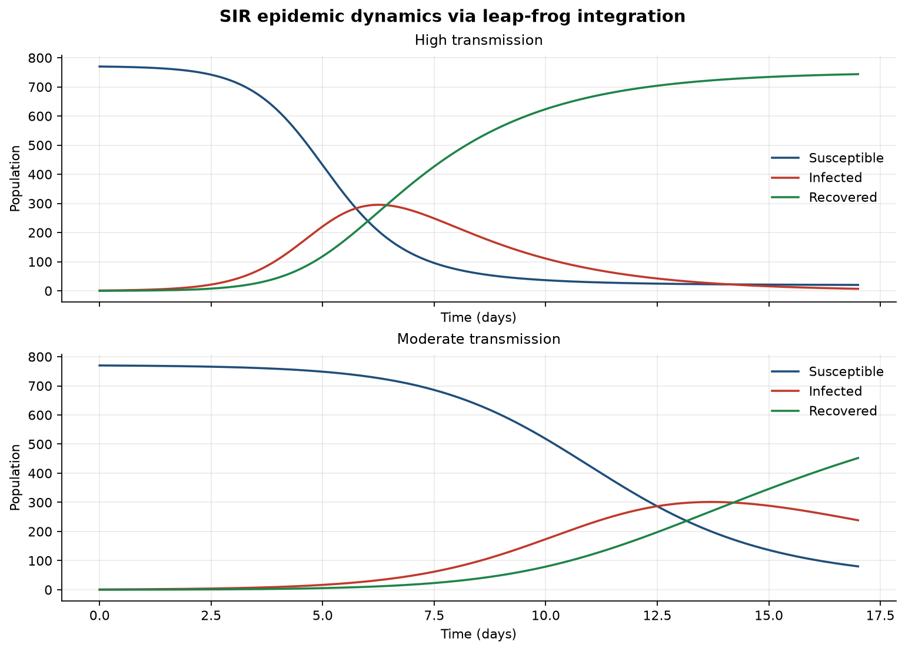
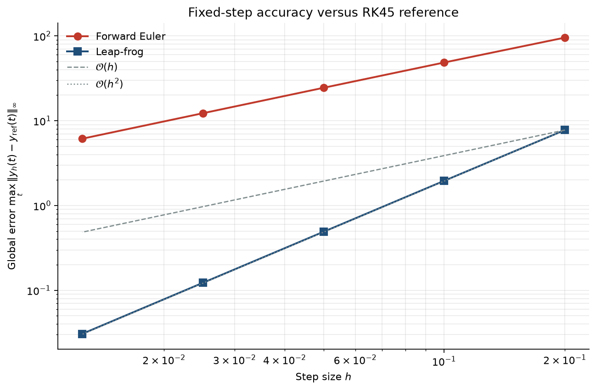

# Leap-Frog Integration of the SIR Epidemic Model

Numerical case study of the classical **Susceptible–Infected–Recovered (SIR)** compartmental model, integrated with the explicit **leap-frog** (centered two-step) method. The project is structured as a small Python package suitable for a data-science / scientific-computing portfolio: typed domain models, interchangeable ODE integrators, a convergence study against an adaptive RK45 reference, reproducible scenarios, tests, and CI.

## Mathematical summary

Closed population $N = S + I + R$ with transmission rate $\beta$ and recovery rate $\gamma$:

$$
\frac{dS}{dt} = -\beta S I, \qquad
\frac{dI}{dt} = \beta S I - \gamma I, \qquad
\frac{dR}{dt} = \gamma I.
$$

On a uniform step $h$, leap-frog advances the state $y = (S, I, R)$ by

$$
y_{n+1} = y_{n-1} + 2h\, f(y_n),
$$

after a forward-Euler starter $y_1 = y_0 + h\, f(y_0)$. Epidemic potential is summarized by

$$
R_0 = \frac{\beta N}{\gamma}.
$$

Accuracy is assessed via the global error against SciPy's adaptive RK45,

$$
E(h) = \max_t \bigl\| y_h(t) - y_{\mathrm{ref}}(t) \bigr\|_\infty,
$$

comparing first-order forward Euler with second-order leap-frog on identical meshes.

Full derivation and discretization details: [`docs/methodology.md`](docs/methodology.md). Package layout: [`docs/architecture.md`](docs/architecture.md).

## What this case study shows

Two calibrated outbreaks on the same population ($N = 771$, one index case) are compared:

| Scenario | $\beta$ | $\gamma$ | $R_0$ | Qualitative outcome |
|----------|---------|----------|-------|---------------------|
| High transmission | $0.0022$ | $0.45$ | $\approx 3.77$ | Early, sharp infection peak |
| Moderate transmission | $0.001$ | $0.2$ | $\approx 3.86$ | Later peak, longer epidemic wave |

Even with similar $R_0$, the $(\beta, \gamma)$ pair reshapes peak timing—an illustration of why reproduction numbers alone do not determine epidemic shape.





## Project layout

```text
sir/           Core package (model, integrators, convergence, analysis, plots)
main.py        CLI entry point
tests/         pytest suite
docs/          Methodology and architecture notes
results/       Generated figures and JSON summaries (local only)
```

## Setup

```bash
python -m venv .venv
source .venv/bin/activate   # Windows: .venv\Scripts\activate
pip install -e ".[dev]"
```

Requires Python 3.10+. Alternatively: `pip install -r requirements.txt`.

## Run

```bash
python main.py
```

Writes:

- `results/sir_leapfrog_comparison.png` — stacked $S,I,R$ trajectories
- `results/method_convergence.png` — $\log E(h)$ vs $\log h$ for Euler and leap-frog
- `results/summary.json` — $R_0$, peak day/height, attack size, population drift
- `results/convergence.json` — per-step errors and observed orders

Optional flags:

```bash
python main.py --scenarios high_transmission
python main.py --convergence-scenario moderate_transmission
python main.py --skip-convergence
python main.py --output-dir results
```

## Tests

```bash
pytest -q
```

Coverage includes parameter validation, population conservation, $R_0$-threshold behaviour, peak timing, and observed convergence orders versus RK45. GitHub Actions runs the same suite on Python 3.10 and 3.12.

## Design highlights

- **Typed domain layer** — immutable dataclasses for parameters, state, and results
- **Interchangeable integrators** — leap-frog, forward Euler, and RK45 reference on a shared mesh
- **Measured accuracy** — global-error study with observed $\mathcal{O}(h)$ / $\mathcal{O}(h^2)$ orders
- **Reproducible scenarios** — experiment configs isolated from the solver
- **Installable package** — `pyproject.toml` with optional `dev` extras and CI

## License

MIT
