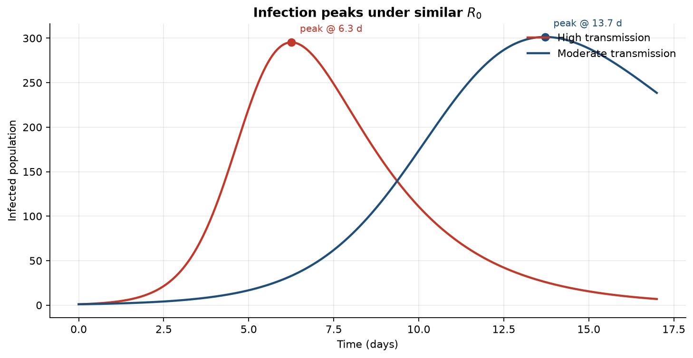

# Leap-Frog Integration of the SIR Epidemic Model

A numerical case study of the classical **Susceptible–Infected–Recovered (SIR)** model, solved with the explicit **leap-frog** method. The narrative below is the portfolio story: epidemic shape, peak timing under similar $R_0$, and why leap-frog is the right fixed-step scheme here.

Reproduce every figure with:

```bash
pip install -e ".[dev]"
python main.py
```

---

## 1. The question

In a closed population of size $N$,

$$
\frac{dS}{dt} = -\beta S I, \qquad
\frac{dI}{dt} = \beta S I - \gamma I, \qquad
\frac{dR}{dt} = \gamma I,
$$

with basic reproduction number

$$
R_0 = \frac{\beta N}{\gamma}.
$$

Two outbreaks can share nearly the same $R_0$ and still look very different. This study fixes $N = 771$ and one index case, then varies $(\beta, \gamma)$:

| Scenario | $\beta$ | $\gamma$ | $R_0$ |
|----------|---------|----------|-------|
| High transmission | $0.0022$ | $0.45$ | $\approx 3.77$ |
| Moderate transmission | $0.001$ | $0.2$ | $\approx 3.86$ |

---

## 2. Epidemic trajectories

Leap-frog integration of both scenarios produces the full compartment histories $S(t)$, $I(t)$, $R(t)$:


**Reading the figure.** High transmission burns through susceptibles quickly: a sharp infected wave, then a recovered plateau near the whole population. Moderate transmission stretches the same qualitative arc over a longer horizon—susceptibles decline later, and recovery is still climbing at day 17.

---

## 3. Same $R_0$, different peak timing

Overlaying only the infected curves makes the portfolio takeaway explicit:



| Scenario | Peak day | Peak infected | Final attack size |
|----------|----------|---------------|-------------------|
| High transmission | $6.3$ | $\approx 295$ | $\approx 97\%$ |
| Moderate transmission | $13.7$ | $\approx 301$ | $\approx 90\%$ |

Peak heights are comparable; peak **timing** is not. $R_0$ alone does not determine the shape of an outbreak—the $(\beta, \gamma)$ pair does.

---

## 4. Why leap-frog

On a uniform step $h$, leap-frog advances $y = (S, I, R)$ by

$$
y_{n+1} = y_{n-1} + 2h\, f(y_n)
$$

(after one Euler starter step). Against SciPy's adaptive RK45 reference, the global error

$$
E(h) = \max_t \bigl\| y_h(t) - y_{\mathrm{ref}}(t) \bigr\|_\infty
$$

behaves as expected for each fixed-step scheme:


| Method | Formal order | Observed order |
|--------|--------------|----------------|
| Forward Euler | $\mathcal{O}(h)$ | $\approx 0.99$ |
| Leap-frog | $\mathcal{O}(h^2)$ | $\approx 2.00$ |

Leap-frog is not only epidemiologically useful here—it is numerically second-order on this problem, which is the justification for preferring it over forward Euler.

Details: [`docs/methodology.md`](docs/methodology.md) · layout: [`docs/architecture.md`](docs/architecture.md).

---

## Project layout

```text
sir/           Model, leap-frog / Euler / RK45, convergence, analysis, plots
main.py        CLI — regenerates all storytelling figures + JSON summaries
tests/         pytest (conservation, peaks, observed orders)
docs/figures/  Plots embedded in this README
.github/       CI on Python 3.10 and 3.12
```

## Setup & run

```bash
python -m venv .venv
source .venv/bin/activate
pip install -e ".[dev]"
python main.py
pytest -q
```

Artifacts under `results/`:

- `sir_leapfrog_comparison.png` — full $S,I,R$ trajectories
- `infection_peaks.png` — infected overlay with peak markers
- `method_convergence.png` — $\log E(h)$ vs $\log h$
- `summary.json`, `convergence.json`

```bash
python main.py --scenarios high_transmission
python main.py --skip-convergence
```

## Design highlights

- Typed domain models and interchangeable integrators on a shared mesh
- Measured accuracy: observed $\mathcal{O}(h)$ / $\mathcal{O}(h^2)$ vs RK45
- Figures first in the README; code structured so those figures stay reproducible
- Installable package (`pyproject.toml`) with CI
